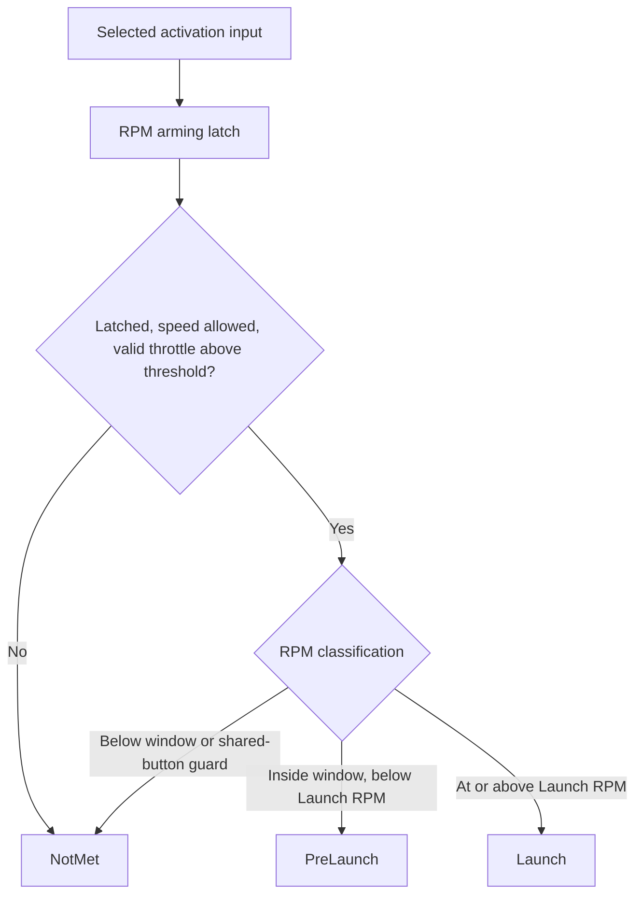

# Launch Control

This guide describes the native `EFI_LAUNCH_CONTROL` implementation, checked
against firmware revision `187e7e0f480`. Launch control combines an activation
input, an optional RPM arming latch, speed and throttle gates, and an RPM window.
It can request absolute ignition timing, ignition skipping, fuel enrichment,
and full fuel/ignition cuts. These requests are independent settings.

The shared [TunerStudio menu](../../firmware/tunerstudio/top_level_menu.ini)
places the dialog at **Advanced > Launch Control**. Field names below match
the [dialog template](../../firmware/tunerstudio/tunerstudio.template.ini);
board-specific menus and available input pins can differ. The source of truth
for stored settings is [rusefi_config.txt](../../firmware/integration/rusefi_config.txt).

## Activation and arming

`launchControlEnabled` enables the controller. `launchActivationMode` selects
the raw activation input:

| Value / enum | Activation Mode | Input |
| --- | --- | --- |
| 0 / `SWITCH_INPUT_LAUNCH` | Launch Button | `launchActivatePin`, interpreted using `launchActivatePinMode`. |
| 1 / `CLUTCH_INPUT_LAUNCH` | Clutch Down Switch | `getClutchDownState()`: configured clutch-down pin/mode, or `engineState.lua.clutchDownState` when no hardware pin is available. |
| 2 / `ALWAYS_ACTIVE_LAUNCH` | Speed Based | Raw input is always true; the other gates still apply. |
| 3 / `STOP_INPUT_LAUNCH` | Brake Pedal | `getBrakePedalState()`: configured brake pin/mode, or `engineState.lua.brakePedalState` when no hardware pin is available. |
| 4 / `LUA_LAUNCH` | Lua | `luaLaunchState`, set with `setLaunchTrigger(0)` or `setLaunchTrigger(1)`. |

Clutch and brake helpers read the logical input directly; launch does not use
the slow-loop switched-state objects. Pin mode supplies pull-up/pull-down and
inversion. The launch button path only refreshes its cached input when the pin
is valid, and skips physical reads in simulator builds. Configure and verify
the actual logical input rather than interpreting an unassigned pin as a
working switch.

**Launch RPM Threshold (0=off)** (`launchRpmThreshold`) is an arming threshold,
separate from the RPM to hold during launch:

- At zero, `isLaunchLatched` follows the raw activation input each update.
- Above zero, a false-to-true input transition latches launch only if
  `rpm <= launchRpmThreshold` at that update. An input already true on the first
  update is also treated as a rising edge because the previous state starts false.
- Once latched, increasing RPM above the threshold does not disarm launch.
  Releasing the input clears the latch.
- Activating above the threshold leaves the latch false. Lowering RPM while
  continuing to hold the input does not arm it; release and reactivate.

This gate applies to **all** activation modes, including Lua and Brake Pedal.
Speed Based has an always-true raw input, so it has no ordinary release/repress
edge. With a nonzero threshold it can latch on the first eligible update, or
remain unlatched if that initial update was above the threshold. A speed change
does not rearm it. Use a zero threshold when no input-edge arming is intended.

Arming does not require the speed, throttle, or launch-window conditions.
Those conditions can become true later while the input remains held. Losing
one of them suppresses launch activity without clearing an existing latch.

## Speed, throttle and RPM conditions

All activation modes use the following gates:

| Gate | Exact behavior |
| --- | --- |
| Speed Threshold (`launchSpeedThreshold`) | Zero bypasses the speed check. Otherwise `int(VehicleSpeed) < launchSpeedThreshold`. Equality disables launch. Internal speed is km/h; the interface can display mph. The conversion to `int` truncates the sensor value. |
| Missing/invalid vehicle speed | `Sensor::getOrZero(VehicleSpeed)` returns zero, so a positive threshold still permits launch. This is not a speed-sensor validity check. |
| TPS Threshold (`launchTpsThreshold`) | Requires a valid `DriverThrottleIntent` and a value **strictly greater** than the threshold. Equality fails. |
| Driver throttle intent | Accelerator pedal when that sensor is configured, otherwise TPS1; see [init_tps.cpp](../../firmware/init/sensor/init_tps.cpp). With an electronic throttle, this need not be the measured throttle-plate position. |
| RPM input | `Sensor::getOrZero(Rpm)` supplies the RPM; the launch controller has no separate RPM-validity gate. |

The default/fixup path enforces a minimum TPS Threshold of 3. Tests that set it
directly to zero bypass that configuration fixup.

Define:

```text
R = launchRpm
W = launchRpmWindow
E = launchCorrectionsEndRpm
S = R - W                    start of pre-launch
F = R - E                    end of correction ramps
```

When the latch, speed and throttle gates pass, the RPM classification is:

| RPM | State |
| --- | --- |
| `rpm < S` | `NotMet` |
| `S <= rpm < R` | `PreLaunch` |
| `rpm >= R` | `Launch` |

The shared-button flat-shift guard described below can force the RPM
classification to `NotMet`. There is no RPM hysteresis: falling below `R`
returns to pre-launch, and falling below `S` ends launch activity. With `W = 0`
there is no pre-launch interval.



## Settings and their effects

The activation settings above select when launch is eligible. These settings
select the resulting torque and fuel behavior:

| TunerStudio field | Configuration field | Effect |
| --- | --- | --- |
| Launch Control | `launchControlEnabled` | Enables launch updates and the guarded launch consumers. See the runtime-disable limitation below. |
| Launch RPM | `launchRpm` | `R`, the boundary between pre-launch and launch. |
| Launch Control Window | `launchRpmWindow` | `W`, an RPM distance **below** `R`. |
| Launch Corrections End RPM | `launchCorrectionsEndRpm` | `E`, another distance below `R`, not an absolute engine speed. Both timing and ignition-skip ramps finish at `F = R - E`. |
| Use Absolute Timing at Launch | `enableLaunchRetard` | Enables the launch timing override in the running-advance calculation. |
| Absolute Timing at Launch | `launchTimingRetard` | Absolute advance in degrees BTDC. `10` means 10 degrees BTDC; `-10` means 10 degrees ATDC. It is not a number of degrees to subtract. |
| Smooth Retard Mode | `launchSmoothRetard` | Interpolates from the current running advance to the absolute launch angle between `S` and `F`. |
| Ignition Cut | `launchSparkCutEnable` | Enables pre-launch spark skipping, 100% skipping in launch, and the full ignition-cut request above `R`. |
| Initial Ignition Cut % | `initialIgnitionCutPercent` | Skip percentage at `S`. |
| Final Ignition Cut % Before launch | `finalIgnitionCutPercentBeforeLaunch` | Skip percentage reached at `F` and held below `R`. At `R` the request becomes 100%. |
| Fuel Cut | `launchFuelCutEnable` | Requests a full fuel cut when launch is active and `rpm > R`. There is no pre-launch fuel-cut ramp. |
| Fuel Added % | `launchFuelAdderPercent` | Multiplies running fuel by `1 + percent / 100` in `Launch` only. No launch enrichment in `PreLaunch`. |

The two cut enables, timing enable, and fuel adder are independent. Enabling
launch alone does not select a cut or a timing change. Generic defaults include
Launch RPM 3000, Window 500, Speed Threshold 30 km/h, and TPS Threshold 3;
these are initialization values, not a calibrated tune for a particular engine.

For a nonzero ramp window, keep `0 <= E < W` so the interpolation interval has
positive width. Keep `W <= R` if the pre-launch region is intended to start at
a nonnegative RPM. The launch code does not validate these relationships;
`interpolateClamped()` assumes ordered endpoints. A zero window intentionally
bypasses pre-launch ramps.

### Absolute timing and smooth retard

With absolute timing enabled and Smooth Retard Mode disabled, the running
advance changes to `launchTimingRetard` as soon as pre-launch begins at `S`.
With smoothing enabled, it interpolates from the running advance at the
**current RPM/load** to the launch angle over `[S, F]`, then holds that angle.
It does not capture a fixed starting angle when the window is first entered.
In `Launch`, it returns the launch angle directly.

The override is in `getRunningAdvance()`. It takes precedence there over the
later shift-torque-reduction and nitrous timing branches. It is not a final
coil-angle clamp: IAT/CLT, idle and DFCO corrections, Lua timing scaling/addition,
knock and soft-rev-limit retard, and per-cylinder/latency adjustments can still
affect the downstream result. **Fixed timing mode bypasses the running-advance
path**, including the launch timing override and its regular spark-skip target
refresh. Inspect the final timing channels when checking behavior.

### Spark skipping versus the full cut

With Ignition Cut enabled, launch requests a skip ratio of:

```text
NotMet:    0
PreLaunch: interpolateClamped(S, initialPercent / 100,
                             F, finalPercent / 100, rpm)
Launch:    1
```

`EngineState::updateSparkSkip()` adds launch and shift-torque-reduction requests
to the **hard** `SoftSparkLimiter`. The class name covers both limiters: the
hard instance permits consecutive skips, including 100% cut; the soft instance
forces a firing opportunity after each skip. Launch never uses that soft
instance. Lua and the selected traction-control skip path can add requests;
the sum is not clamped in `updateTargetSkipRatio()`.

At each eligible ignition event, `spark_logic.cpp` uses the limiters to decide
whether to skip scheduling that event. Hard skips use a pseudorandom comparison
against the requested ratio, so a partial percentage is not a fixed repeating
cylinder pattern. The `luaIgnitionSkip` output reports this combined per-event
decision despite its Lua-specific name.

Separately, `LimpManager` requests `ClearReason::LaunchCut` for fuel and/or spark
when the corresponding cut is enabled, `isLaunchCondition` is true, and
`rpm > retardThresholdRpm`. That threshold is set to `launchRpm` each enabled
launch update. This produces an important boundary difference:

- **At exactly `R`**: launch state, absolute timing/enrichment if enabled, and
  100% launch spark-skip request; no launch `LimpManager` full-cut request yet.
- **Above `R`**: the same launch state plus the enabled full-cut requests.

Thus pre-launch ignition skips do not require a "launch control" cut code.
Other protection requests can also suppress fuel or spark; launch does not
override them.

The [main rev limiters](rev_limiters.md) have independent thresholds and
enables. Their soft timing retard can subtract from launch's absolute angle,
and their running-fuel multiplier can combine with launch enrichment. The main
hard cut has hysteresis; launch's RPM classification and full-cut request do not.

### Fuel and feedback learning

`getRunningFuel()` applies the launch fuel coefficient with the other running
fuel multipliers, before downstream injector calculations and cuts. Fuel Added
% changes calculated fuel; it does not restore injection during a fuel cut.

`isLaunchOrPreLaunchCondition()` gates both fuel-trim learning paths whenever
launch is enabled and either activity state is true, even if its cut/timing
options are off:

- STFT pauses cell updates and retains the selected cell's existing adjustment.
  It reports `stftDisabledLaunch` in the per-bank learning state when no earlier
  disable condition takes precedence. It does not force the correction to 1.
- LTFT learning stops (`ltftLearning = false`); existing trims remain available
  through the ordinary correction path.

See [fueling](fueling_system.md) and [protection](protection_system.md).

## Sharing an input with flat shift

Launch and shift torque reduction share code infrastructure, but their trigger
arbitration differs by input:

| Configuration | Arbitration |
| --- | --- |
| Launch = Clutch Down Switch; torque reduction = Clutch Down Switch; launch enabled; `launchRpmThreshold > 0` | While `isLaunchLatched` is true, `ownsSharedTrigger()` suppresses flat shift. Ownership does not require current launch RPM, speed or TPS conditions. Release the clutch to clear it. A press above the launch arming threshold leaves launch unlatched and permits flat shift if its own gates pass. |
| Launch = Launch Button; torque reduction = Launch Button; torque reduction enabled | `calculateRPMLaunchCondition()` returns `NotMet` at `rpm >= torqueReductionArmingRpm`, regardless of the launch latch. This RPM guard does not check the other torque-reduction gates. The clutch ownership rule does not apply. |
| Other combinations, or clutch sharing with `launchRpmThreshold = 0` | No latch-based launch ownership exclusion. Check both controllers' conditions; do not assume they are mutually exclusive. |

For example, with launch arming at 2000 RPM and Launch RPM 4000, pressing the
shared clutch at 1500 RPM arms launch and retains ownership while revving to
4000. After releasing it, pressing again at 6000 RPM does not arm launch, so
flat shift can operate if its RPM, throttle, temperature and time conditions
permit. This is the behavior covered by the latch regression tests.

## Worked RPM example

For illustration, set `R = 4000`, `W = 500`, `E = 50`, initial cut 10%, final
cut 40%, Fuel Added 10%, and an absolute angle of -10 degrees. Assume all gates
pass, dynamic timing, smooth retard and both cuts enabled. For the timing
column only, assume the running advance before launch is a constant 20 degrees.
These numbers demonstrate the arithmetic, not recommended tuning values.

| RPM | State | Launch timing result before later corrections | Launch spark-skip request | Launch fuel coefficient | Launch full-cut request |
| --- | --- | --- | --- | --- | --- |
| 3499 | NotMet | 20 degrees | 0% | 1.00 | None |
| 3500 | PreLaunch | 20 degrees | 10% | 1.00 | None |
| 3725 | PreLaunch | 5 degrees | 25% | 1.00 | None |
| 3950 | PreLaunch | -10 degrees | 40% | 1.00 | None |
| 3999 | PreLaunch | -10 degrees | 40% | 1.00 | None |
| 4000 | Launch | -10 degrees | 100% | 1.10 | None |
| 4001 | Launch | -10 degrees | 100% | 1.10 | Fuel and ignition |

## Execution order and lifecycle limitations

Launch is an `Engine` member, not an independently scheduled `EngineModule`.
The normal fast callback runs at 200 Hz (5 ms); see
[scheduling](scheduling_system.md). Its relevant order is:

1. Compute fuel mass and STFT/LTFT using the **previous** launch state.
2. Update launch, including the input edge/latch, activity bits and skip ratio.
3. Update shift torque reduction, which sees the new latch ownership.
4. Compute ignition advance. The running-advance path refreshes the combined
   spark-skip targets and uses the new launch state for timing.
5. Run module fast callbacks, including `LimpManager`'s cut evaluation.
6. Trigger-driven spark scheduling consumes the skip targets and cut decisions.

Fuel enrichment and fuel-trim gating can therefore lag a launch transition by
one normal fast-loop iteration. The exact event timing also depends on when
the trigger scheduler consumes the computed state.

The following are current implementation limitations, not promised features:

- `LaunchControlBase::update()` returns immediately when launch is disabled;
  it does not clear the activity bits, input history, latch or cached skip
  ratio. Timing, fuel coefficient, learning gates, shared-trigger ownership,
  and full-cut helpers explicitly check enable, but `getSparkSkipRatio()`
  returns the cached ratio without that guard. Disabling an already-active
  launch can leave a stale skip contribution. Existing disabled-at-start
  tests do not establish safe clearing on a runtime disable.
- `launchActivateDelay` remains in the configuration layout but has no native
  runtime consumer or current launch-dialog control. There is no implemented
  activation delay or maximum launch duration in this controller.
- `isValidInputPin` exists in live data but the launch implementation never
  assigns it. It cannot establish whether the input is configured correctly.
- There is no native launch boost-duty override here. Do not infer one from
  old examples or commented-out `launchBoostDuty` test code; boost control
  and Lua boost requests are separate paths.
- `setLaunchTrigger()` takes an integer, not a Lua boolean. Its value has no
  timeout, and `Engine::resetLua()` does not clear `luaLaunchState` or the Lua
  soft/hard spark-skip fields. Scripts must explicitly maintain/clear their
  requests; reloading a script is not proof that these requests are zero.

Using Activation Mode = Lua changes the activation input only; all native
gates and effects still apply. A script that instead calls spark-skip, timing
or cut setters implements its own policy and does not automatically set native
launch activity bits, latch ownership or launch learning inhibition. See
[Lua implementation injection](lua_implementation_injection.md) and the
[example script](../../firmware/controllers/lua/examples/launch_control.lua),
which is illustrative rather than a complete mirror of the current controller.

## Diagnostics and review procedure

The launch dialog includes the generated `launch_control_state` panel.
Fields come from [launch_control_state.txt](../../firmware/controllers/algo/launch_control_state.txt)
via [LiveData.yaml](../../firmware/integration/LiveData.yaml).

| Field | Meaning |
| --- | --- |
| `activateSwitchCondition` | Latest raw activation input, before latch and other gates. |
| `isLaunchLatched` | Result of the optional RPM-on-activation arming gate. |
| `speedCondition`, `tpsCondition` | Individual speed and valid-throttle gates. |
| `rpmPreLaunchCondition`, `rpmLaunchCondition` | RPM classification before speed/throttle/latch gating, but after the shared-button RPM guard. |
| `isPreLaunchCondition`, `isLaunchCondition` | Combined activity state; `isLaunchCondition` is logged as "Launch Control Triggered". A false triggered bit does not rule out pre-launch cuts. |
| `isSwitchActivated`, `isClutchActivated`, `isBrakePedalActivated` | Which activation mode is selected, not whether that switch is pressed. |
| `launchActivatePinState` | Cached dedicated launch-button reading; not the selected input in every mode. |
| `luaLaunchState` | Lua activation request. |
| `retardThresholdRpm` | Launch RPM used by the full-cut helper, despite its name; not the beginning of the timing ramp. |
| `isValidInputPin` | Unmaintained field; see limitation above. |

Review a log in this order:

1. Confirm launch enable, activation mode, input pin/mode and raw input. Check
   pedal/TPS validity and vehicle-speed behavior independently.
2. If raw input is true but the latch is false, inspect RPM at the activation
   edge. If the threshold was exceeded, a release and a new edge are required.
3. Inspect speed, throttle and RPM condition bits. Speed gating applies to
   button and clutch modes too. Check the shared-button torque-reduction
   arming RPM if the RPM bits unexpectedly stay false.
4. Compare both activity bits with final timing, `luaIgnitionSkip`, fuel/ignition
   cut codes, STFT learning state and `ltftLearning`. A pre-launch skip can occur
   without a full-cut code; cached launch bits can remain set after disable.
5. For a shared clutch, check `isLaunchLatched` before diagnosing an absent
   flat-shift request. For missing enrichment, distinguish `PreLaunch` from
   `Launch` and account for the fuel-calculation ordering.

## Source and regression-test map

| Area | Source / existing coverage |
| --- | --- |
| Activation, latch, RPM states, coefficients and limiter | [launch_control.cpp](../../firmware/controllers/algo/launch_control.cpp), [header](../../firmware/controllers/algo/launch_control.h); [basic launch tests](../../unit_tests/tests/test_launch.cpp). |
| RPM boundaries and full-cut threshold | [test_rpm_condition.cpp](../../unit_tests/tests/launch/test_rpm_condition.cpp), [test_retard_threshold_rpm.cpp](../../unit_tests/tests/launch/test_retard_threshold_rpm.cpp). |
| Arming latch and shared-clutch arbitration | [test_launch_rpm_threshold.cpp](../../unit_tests/tests/launch/test_launch_rpm_threshold.cpp), [shift controller](../../firmware/controllers/algo/shift_torque_reduction_controller.cpp). |
| Ignition ramp and target aggregation | [ignition_state.cpp](../../firmware/controllers/algo/ignition/ignition_state.cpp), [engine2.cpp](../../firmware/controllers/algo/engine2.cpp); [timing tests](../../unit_tests/tests/launch/test_ignition_angle_advance.cpp), [skip-ratio tests](../../unit_tests/tests/launch/test_spark_skip_ratio.cpp), [target aggregation tests](../../unit_tests/tests/launch/test_launch_target_skip_ratio.cpp). |
| Full cut and event skipping | [limp_manager.cpp](../../firmware/controllers/limp_manager.cpp), [spark_logic.cpp](../../firmware/controllers/engine_cycle/spark_logic.cpp); `LaunchControl.hardSkip` covers the hard limiter's skip behavior. |
| Fuel coefficient and learning inhibition | [fuel_math.cpp](../../firmware/controllers/algo/fuel_math.cpp), [closed_loop_fuel.cpp](../../firmware/controllers/math/closed_loop_fuel.cpp), [long_term_fuel_trim.cpp](../../firmware/controllers/long_term_fuel_trim.cpp); `ClosedLoopFuel.pausedDuringTwoStepLaunch` in [test_stft.cpp](../../unit_tests/tests/test_stft.cpp), `LTFT.pausedDuringTwoStepLaunch` in [test_long_term_fuel_trim.cpp](../../unit_tests/tests/controllers/test_long_term_fuel_trim.cpp). |
| Lua trigger and reset behavior | [lua_hooks.cpp](../../firmware/controllers/lua/lua_hooks.cpp), [engine.cpp](../../firmware/controllers/algo/engine.cpp). |

From `unit_tests/`, a focused source build and test selection is:

```bash
make -j12
build/rusefi_test --gtest_filter='LaunchControl.*:launchRpmThreshold.*:rpmCondition.*:IgnitionAngleAdvanceTest.*:SparkSkipRatioTest.*:LaunchTargetSkipRatioTest.*:ClosedLoopFuel.pausedDuringTwoStepLaunch:LTFT.pausedDuringTwoStepLaunch'
```

These host tests exercise logic with mocked sensors/pins. They do not validate
physical wiring, an engine-specific calibration, or every lifecycle/boundary
case described above. In particular, the runtime-disable cache, Speed Based
edge behavior and Lua reload omissions are source-review findings, not claims
of dedicated regression coverage.


## Rolling launch

The report-55 port from AlphaX `ebb877615ee1` adds `RollingLaunchControl` alongside
standing launch. It shares `EFI_LAUNCH_CONTROL` with the hard spark limiter and
uses the main configuration page, rather than the fork's custom page. See
`controllers/modules/rolling_launch/` for the controller, defaults, schema and
telemetry; the shared menu is **Advanced > Rolling Launch Control**.

At the 20 Hz slow callback, the hardware switch and numeric Lua
`setRollingLaunchTrigger(1/0)` request are OR-ed. Valid, finite RPM and VSS must
meet inclusive minimum gates, with RPM positive. On each false-to-true armed
transition, capture RPM and cap `captured + window` at `rollingLaunchMaxRpm`.
A held trigger can therefore arm on gate recovery without a new button edge.

While armed, skip interpolates across the captured window, fixed relative
retard is applied, and running fuel receives the configured percentage adder.
For a zero/collapsed window, cut at the capped target, including when capture
occurred above the ceiling. Skip adds to existing hard-limiter requests in
`EngineState::updateSparkSkip()`. It does not affect the soft limiter. Timing is
subtracted in `getAdvanceCorrections()`; fixed-timing mode bypasses it.

On release or gate loss, skip and fuel return to neutral at the next slow
callback; timing decays linearly over the configured ramp time. Re-arming
cancels the ramp and captures a new target. Disabling the feature, engine stop,
and configuration burn clear the controller state. The Lua request remains
latched until a script explicitly clears it or `Engine::resetLua()` runs on
script reload. Lua reset clears only the Lua request: the next slow callback
releases the hold with normal timing ramp-out, unless the hardware switch still
requests activation. Repeated resets do not restart the ramp. Tests
`RollingLaunch.LuaResetReleasesHoldAndRampsOutTiming` and
`RollingLaunch.LuaResetPreservesHardwareRequest` cover both paths.

`isRollingLaunchActive` reports the raw request and `isRollingLaunchArmed`
reports the hold. `unit_tests/tests/test_rolling_launch.cpp` covers the fork's
six original cases, above-ceiling capture, invalid sensor gates, stale switch
state, lifecycle reset, re-arming, actual Lua/pin inputs and the fuel/timing/skip
integration. These are host tests, not hardware or vehicle validation.
