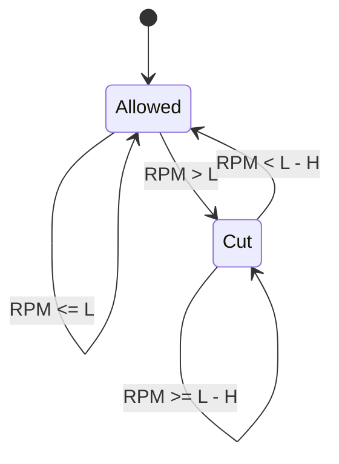

# Rev Limiters

This guide describes the native RPM-limiting paths, reviewed against firmware
revision `26e4cee117c`. They share RPM inputs but have separate settings, state
and outputs; there is no single combined "active RPM limit" value.

| Mechanism | Action | Where implemented |
| --- | --- | --- |
| Main hard RPM limit | Cuts fuel, spark, or both above a constant or coolant-based limit, with hysteresis. | `LimpManager::updateState()` |
| Main soft RPM window | Progressively subtracts timing and/or adds running fuel below the same hard limit. | `LimpManager::updateRevLimit()`, fuel and ignition math |
| Electronic throttle RPM limit | Tapers the throttle target toward closed over its own RPM range. | `EtbController::getSetpointEtb()` |
| Fault RPM limit | Forces a fuel cut above a latched fault ceiling, independently of the main cut enables. | `LimpManager`, triggered by ETB jam or fatal error |
| Launch/two-step | Separate activation gates, RPM window, absolute timing, spark skipping and cuts. | [Launch control](launch_control.md) |

The general limiter's **soft timing/fuel window**, the **ETB soft limiter** and
the `SoftSparkLimiter` class used by launch/traction/Lua are different
mechanisms. The main hard limit does not progressively skip a percentage of
sparks: it requests a full cut for each enabled output.

## Settings and tuning interface

The shared [TunerStudio template](../../firmware/tunerstudio/tunerstudio.template.ini)
places these settings under **Setup > Limits and protection > Limits and
fallbacks**. Board-specific menus can differ. Definitions, ranges and storage
scales come from [rusefi_config.txt](../../firmware/integration/rusefi_config.txt).

| Panel / field | Configuration field | Meaning |
| --- | --- | --- |
| Limits / Cut fuel on RPM limit | `cutFuelOnHardLimit` | Enables the main RPM fuel cut **and** the soft-window fuel multiplier. |
| Limits / Cut spark on RPM limit | `cutSparkOnHardLimit` | Enables the main RPM spark cut **and** soft-window timing retard. |
| Limits / Use Engine Temperature RPM limit curve | `useCltBasedRpmLimit` | Selects the coolant curve instead of the constant hard limit. |
| Limits / RPM hard limit | `rpmHardLimit` | Constant limit in RPM, used only when coolant-based limiting is off. UI range 0..20000. Zero is **not** a disable value. |
| Limits / RPM limit hysteresis | `rpmHardLimitHyst` | RPM distance below the selected limit used both for cut recovery and as the width of the timing/fuel ramp. Stored in 10 RPM increments; UI range 0..2500. |
| Soft RPM Limit / Timing retard | `rpmSoftLimitTimingRetard` | Maximum degrees **subtracted** from timing at the top of the window, not an absolute ignition angle. UI range 0..50 degrees, 0.2-degree storage increments. |
| Soft RPM Limit / Fuel added | `rpmSoftLimitFuelAdded` | Maximum percent added to running fuel at the top of the window. UI range 0..50%, 0.2-percentage-point storage increments. |
| Engine Temperature RPM Limit / curve | `cltRevLimitRpmBins`, `cltRevLimitRpm` | Four coolant-temperature points and their RPM limits. Internal temperature is degrees C; the UI can display degrees F. |
| Electronic Throttle Limiting / Soft limiter start | `etbRevLimitStart` | Start of throttle taper, independent of the main hard limit. Zero disables this taper. UI range 0..15000 RPM. |
| Electronic Throttle Limiting / Soft limiter range | `etbRevLimitRange` | RPM distance above the start at which the pre-clamp throttle target reaches zero. UI range 0..2000 RPM. |

The UI hides the Soft RPM Limit panel when coolant-based limiting is selected.
**The firmware still applies those stored timing/fuel settings around the
coolant-derived limit.** UI visibility does not disable the correction. The
constant hard-limit field is likewise inactive in coolant mode, but in that
case the firmware really does replace it with the curve result.

Generic defaults in [default_base_engine.cpp](../../firmware/controllers/algo/defaults/default_base_engine.cpp)
set a 7000 RPM hard limit, 50 RPM hysteresis, both cuts enabled, 4 degrees of
soft retard, and a 250 RPM ETB range. ETB start and soft fuel addition remain
zero in the generic zero-initialized configuration. Engine/board presets can
override these values. The generic CLT setup initializes only the temperature
axis (`-20, 0, 40, 80` degrees C); populate and inspect all RPM values before
enabling the curve. These defaults are not an engine-specific calibration.

## Selecting the main limit

`LimpManager::updateRevLimit(rpm)` computes:

```text
L = useCltBasedRpmLimit
      ? interpolate2d(Clt, cltRevLimitRpmBins, cltRevLimitRpm)
      : rpmHardLimit
H = rpmHardLimitHyst
B = L - H                  lower boundary / resumeRpm
```

The curve is linearly interpolated between ordered temperature bins and clamped
to its endpoint values outside the temperature range. Its result can be a
fractional RPM. It **replaces**, rather than takes the minimum with,
`rpmHardLimit`; it can therefore select a higher or lower RPM than that field.

The CLT read uses `Sensor::getOrZero(Clt)`. A missing/invalid coolant reading
selects the curve value at **0 degrees C**; there is no fallback to the constant
hard limit, last good temperature, or lowest curve value in this code.
Both RPM and coolant are sampled again as the controller runs. A coolant or
tune change can move `L` and `B` while the engine is already inside a limit
window; the current hysteresis state is evaluated against those new boundaries.

For ordinary cut recovery at nonnegative RPM, keep `H < L` for every possible
curve result. If `B <= 0`, a cut cannot clear by dropping RPM to zero because
recovery requires RPM **strictly below** `B`. Setting `rpmHardLimit = 0` does
not disable this path: positive RPM exceeds that limit. The cut-enable settings
control the main limiter's fuel/spark actions.

## Hard-cut state and exact boundaries

The main limiter uses [Hysteresis](../../firmware/controllers/hysteresis.h)
with strict comparisons. Its state starts false:

```text
if rpm > L:       cutState = true
else if rpm < B:  cutState = false
else:             keep the previous cutState
```

Thus equality at either boundary preserves the state. The setting's existing
help text describes reaching the thresholds loosely; the strict comparisons
above and `limp.revHardLimitHyst` are the implementation behavior.



When `cutState` is true, the main limiter requests `ClearReason::HardLimit`
for each enabled output. Fuel and spark enables are independent; disabling both removes the main
RPM cut and makes its soft corrections neutral. Other protections, launch,
Lua cuts and ETB limiting still apply.

The hysteresis state is evaluated even with both cut enables off. Re-enabling
an output while the state remains latched can apply that cut immediately;
there is no new-activation-edge requirement. Ordinary configuration changes
do not reconstruct the hysteresis object.

With `H = 0`, the latch sets above `L`, clears below `L`, and keeps its previous
state at exactly `L`. This also removes the positive-width soft ramp.

## Soft timing and fuel window

For `H > 0`, the correction fraction is:

```text
f = clamp((rpm - B) / H, 0, 1)
timingRetard  = f * rpmSoftLimitTimingRetard
fuelMultiplier = 1 + f * rpmSoftLimitFuelAdded / 100
```

`getLimitingTimingRetard()` returns zero unless Cut spark on RPM limit is
enabled. `getLimitingFuelCorrection()` returns 1 unless Cut fuel on RPM limit
is enabled. Setting either maximum correction to zero disables that correction
without disabling its corresponding hard cut.

The ramps depend on **current RPM**, not the cut latch. At `B` they are neutral;
at `L` they reach their maximum even if the hard cut has never activated.
Above `L` they stay at maximum. During recovery, they ramp back down while the
hard cut remains latched until RPM drops below `B`.

The zero-width (`H = 0`) case uses the actual `interpolateClamped()` endpoint
order: the correction is neutral at or below `L` and at maximum above it.
There is no division by zero in that branch, but no gradual ramp either.

### Where the corrections apply

`getRunningFuel()` multiplies running fuel by `fuelMultiplier` with the other
running-fuel corrections. Launch enrichment and the main soft-limit fuel
addition multiply together when both are active. Later injector conversion,
fuel trims and cuts still apply; enrichment does not restore a cut injection.
The ordinary separate cranking-fuel path does not use this running multiplier.

In `EngineState::periodicFastCallback()`, soft retard is subtracted after
`getWrappedAdvance()` and alongside knock retard, only with
`timingMode == TM_DYNAMIC`. It can further retard the result of launch's
absolute-timing override or Lua timing adjustments. Per-cylinder trim and
hardware-latency adjustment occur later. In fixed timing mode this soft retard
is bypassed; the fuel correction and hard fuel/spark cuts remain independent.

Neither the main soft ramp nor throttle taper by itself creates a
`ClearReason::HardLimit` cut code.

### Worked example

For illustration, use `L = 7200`, `H = 200`, 10 degrees maximum retard, 20%
maximum fuel addition, both cuts enabled, and dynamic timing. These values
demonstrate the arithmetic rather than prescribe a tune. Assume no other cuts.

| Step | RPM | Hard-cut state after update | Timing removed | Running-fuel multiplier |
| --- | --- | --- | --- | --- |
| Rising, below window | 6999 | Off | 0 degrees | 1.00 |
| Start of window | 7000 | Off | 0 degrees | 1.00 |
| Halfway | 7100 | Off | 5 degrees | 1.10 |
| Exactly at hard limit | 7200 | Off | 10 degrees | 1.20 |
| Exceeded limit | 7201 | On | 10 degrees | 1.20 |
| Falling through window | 7100 | On | 5 degrees | 1.10 |
| Exactly at resume boundary | 7000 | On | 0 degrees | 1.00 |
| Below resume boundary | 6999 | Off | 0 degrees | 1.00 |

The multiplier column describes calculated running fuel. With fuel cut active,
the limiter still prevents new injection scheduling.

## Electronic throttle RPM limiting

For a controller configured as `DC_Throttle1` or `DC_Throttle2`, the normal
`getSetpointEtb()` path starts with the pedal map, then applies board adjustment,
idle addition, Lua adjustment, antilag addition, throttle-specific trim and
traction-control adjustment. It clamps the resulting target `T` to 0..100%
before the RPM taper:

```text
S = etbRevLimitStart
R = etbRevLimitRange
targetBeforeFinalClamp = interpolateClamped(S, T, S + R, 0, rpm)
finalTarget = clamp(etbMinimumPosition,
                    targetBeforeFinalClamp,
                    min(etbMaximumPosition, 100))
```

At or below `S`, the taper leaves `T` unchanged. At `S + R` and above it
requests zero before the final position clamp. The generic minimum position is
1%, so the final command normally bottoms out at **1%, not 0%**. This matches
`etb.setpointRevLimit` even though some old comments describe fully closing.
The command is a position target, not proof that the physical plate has moved.

With `S = 5000`, `R = 750`, pre-taper `T = 80%` and minimum 1%, the final
targets are 80% at 5000 RPM, 40% at 5375 RPM, and 1% at 5750 RPM or higher.
No hysteresis or RPM latch is used: the taper immediately follows the sampled
RPM in both directions. With `R = 0`, it becomes a step above `S`, preserving
the original target at exactly `S`.

This limit is independent of the coolant curve, main hard limit, cut enables,
and main soft corrections. No code automatically aligns these thresholds.
Set `etbRevLimitStart = 0` to disable the taper; a nonzero range alone does not
enable it. The idle-valve and wastegate controller modes use different setpoint
functions and do not receive this ETB RPM taper. Autotune returns its own target
before the ordinary taper path.

`etbRevLimitActive` is true when the taper changes its input by more than 0.1
percentage point, measured **before the final minimum/maximum clamp**. It is
not a fuel/spark cut flag and is not the ETB-jam fault. The code only assigns
this bit inside the nonzero-start branch; disabling the taper at runtime, or
not reaching the setpoint calculation, can leave its old indication visible.

## Fault-imposed RPM limits

`m_faultRevLimit` starts at `INT32_MAX`. The private `setFaultRevLimit()` only
accepts lower values, retaining the lowest fault ceiling and its reason.
It does not change `m_revLimit`, the normal hysteresis boundary, or the soft
timing/fuel ramps.

| Trigger | Latched effects |
| --- | --- |
| `reportEtbJammed()` | Disallows ETB control and sets a 1500 RPM fault ceiling. The separate fault check cuts fuel when `rpm > 1500`, with reason `EtbJammedRevLimit` (4), regardless of Cut fuel on RPM limit. It does not itself request a spark cut. |
| `fatalError()` | Disallows ETB, ignition, injection and trigger input, and lowers the fault ceiling to zero. The permanent fuel/spark prohibition takes priority, so fatal behavior does not rely on the RPM check or ordinary cut-enable settings. |

The fault fuel check has **no hysteresis**: at exactly its ceiling it does not
request a cut. The fault ceiling and permanent permissions are latched for the
`LimpManager` object's lifetime; the normal ignition-switch/engine-stop paths
do not reset them. ECU reinitialization clears this RAM state; a continuing
fault can report again.

ETB jam detection requires nonzero `etbJamDetectThreshold` and `etbJamTimeout`,
and sustained target-versus-observed position error while ignition is on.
The local `jamDetected` indication can clear when the error clears, but this
does not undo an already latched `LimpManager` fault. The bench-test
`etbIgnoreJamProtection` bypass affects ETB permission only; it does not raise
the fault fuel-cut ceiling. The fault RPM check is compiled under
`EFI_SHAFT_POSITION_INPUT`; the main limiter belongs to `EFI_ENGINE_CONTROL`.

## Execution, competing requests and learning

The normal [fast callback](scheduling_system.md) runs at 200 Hz (5 ms):

1. `EngineState::periodicFastCallback()` calls `updateRevLimit()` before fuel
   mass and ignition math, making the current soft corrections available.
2. It calculates running fuel, fuel trims and ignition advance.
3. Engine-module callbacks run; `LimpManager::onFastCallback()` samples RPM,
   recomputes the boundaries and updates the hard-cut latch and permissions.
4. Trigger-driven injection and spark paths consume those permissions.

The ETB controller normally updates separately at 500 Hz (2 ms). Its position
response and the engine's RPM response are separate from the requested target.
These are sampled control paths, not a guarantee that measured RPM can never
overshoot a configured threshold.

Fuel limiting returns from `handleFuel()` before scheduling new injection
events. Spark limiting prevents new dwell starts and disables multispark for
the limited event, but retains spark-discharge scheduling so a previously
charged coil can fire safely. It is not a blanket cancellation of every
already queued output event.

Each transient fuel/spark permission starts from the corresponding global
injection/ignition enable on every `updateState()`. `Clearable::clear()` keeps
the **first** reason that clears that output in the update. For example, a Lua
cut checked before the hard limiter can mask its reason, while a main hard
cut can mask a later fault or launch reason. Permanent permissions take
priority when `allowInjection()` / `allowIgnition()` return their result.
The reported code is not a list of all simultaneously active conditions.

[Launch](launch_control.md) has its own window and full-cut boundary. At exactly
Launch RPM its hard spark-skip request can already be 100%, whereas the main
RPM cut only latches above its selected limit. Lua `setFuelDisabled()` and
`setIgnDisabled()` add requests; clearing them cannot override another
limiter. Percentage spark skipping from launch, flat shift, traction or Lua
can also suppress ignition without a `LimpManager` hard-limit code. See
[Lua implementation injection](lua_implementation_injection.md).

`LimpManager` refreshes its last-cut timer whenever a transient fuel **or spark**
permission is false. STFT pauses per-cell learning while that timer is less
than 2 seconds old (`stftDisabledFuelCut`), subject to earlier disable reasons,
and retains existing cell adjustments. The soft ramps alone do not refresh
that timer. `LongTermFuelTrim::learn()` checks the global STFT correction state
and has an explicit launch gate, but no equivalent general-cut timer or
per-bank STFT learning-state check. Do not assume LTFT learning stops merely
because a bank's STFT learning state displays Fuel Cut; this is a current
source-review limitation, distinct from the tested launch-specific inhibition.

## Diagnostics and troubleshooting

| Channel / indication | Interpretation |
| --- | --- |
| `fuelCutReason`, `sparkCutReason` | Copied from `LimpManager` in the trigger scheduling paths. Code 3 (`HardLimit`, displayed as "RPM limit") identifies the main hard cut. |
| Cut code 4 (`EtbJammedRevLimit`, "ETB RPM limit") | Fault fuel cut above 1500 RPM after an ETB jam; **not** the configurable throttle taper. |
| Cut code 9 (`LaunchCut`, "launch control") | Native launch full-cut request, separate from launch spark skipping. |
| Cut code 15 (`Lua`) | A Lua full-cut request was the first transient reason. |
| Cut code 1 (`Fatal`) / 20 (`FatalErrorRevLimit`) | Fatal permanent prohibition normally reports 1. The separate zero-RPM fault-ceiling reason is 20, normally masked by the permanent prohibition. |
| `etb1etbRevLimitActive`, `etb2etbRevLimitActive` | Per-controller taper changed the pre-clamp target by more than 0.1%; can be stale after disabling the taper. |
| `etb1m_adjustedTarget`, `etb2m_adjustedTarget` | Final throttle target after RPM taper and position clamps; compare with measured TPS. |
| `etb1adjustedEtbTarget`, `etb2adjustedEtbTarget` | Earlier target after board/idle/Lua adjustments. It precedes antilag, trim and traction adjustments as well as the limiter, so its difference from final target is not exclusively RPM limiting. |
| `baseIgnitionAdvance`, `correctedIgnitionAdvance` | Their difference includes soft-limit retard **and knock retard** in dynamic mode; it is not an isolated limiter-retard channel. |
| Verbose CAN `revLimit` status bit | True for any `LimpManager` fuel or spark prohibition, not just RPM limiting; does not identify the cause or report ETB taper alone. |

`m_revLimit`, `resumeRpm`, `m_timingRetard`, `m_fuelCorrection` and the fault
ceiling are not dedicated live-data fields in this implementation. Derive the
normal boundaries and soft corrections from the tune plus logged RPM/CLT.
The `desiredRpmLimit` reference in `limp_manager.h` is a TODO, not a populated
diagnostic channel.

Cut reasons are copied when the trigger paths run, so a stopped engine or an
early return can leave old values visible; disabling ignition returns before
the spark reason is refreshed. The `*CutReasonBlinker` fields are presentation
copies, not separate protection state. Ordinary RPM cuts do not generate the
30-second warning messages used by boost, injector-duty, lambda and ETB-jam
protection; use the cut codes and RPM trace.

When behavior differs from the expected limit:

1. Confirm both cut enables, constant-versus-CLT selection, all curve points,
   coolant validity and the effective `L`. A curve value can exceed the
   constant field, and invalid CLT uses zero degrees C.
2. Compute `B = L - H` and inspect the RPM history. A cut remaining active
   below `L`, or exactly at `B`, can be correct hysteresis behavior.
3. Inspect timing/fuel settings even if coolant mode hides their panel. Verify
   dynamic versus fixed timing before diagnosing absent soft retard.
4. Check the individual fuel/spark cut codes. A different code, missing code
   or verbose CAN rev-limit bit alone does not rule out another limiting path.
   Boost, injector-duty, lambda and oil-pressure protections can resemble an
   RPM ceiling without using a configured RPM threshold.
5. For ETB, compare start/range, final target, minimum position and measured
   TPS. Distinguish the taper activity bit from a latched 1500 RPM jam limit.
6. For launch or custom Lua limiting, inspect those controllers' conditions
   and requests separately. A cut consumer cannot re-enable an output another
   protection has prohibited.

## Source and regression-test map

| Area | Sources / coverage |
| --- | --- |
| Main and fault limits; cut priority | [limp_manager.cpp](../../firmware/controllers/limp_manager.cpp), [limp_manager.h](../../firmware/controllers/limp_manager.h). |
| Strict hysteresis and interpolation | [hysteresis.h](../../firmware/controllers/hysteresis.h), [hysteresis.cpp](../../firmware/controllers/hysteresis.cpp), [interpolation.cpp](../../firmware/util/math/interpolation.cpp), [curve interpolation](../../firmware/libfirmware/util/include/rusefi/interpolation.h). |
| Soft correction consumers | [engine2.cpp](../../firmware/controllers/algo/engine2.cpp), [fuel_math.cpp](../../firmware/controllers/algo/fuel_math.cpp), [ignition_state.cpp](../../firmware/controllers/algo/ignition/ignition_state.cpp). |
| Throttle taper and jam detection | [electronic_throttle.cpp](../../firmware/controllers/actuators/electronic_throttle.cpp), [live-data definitions](../../firmware/controllers/actuators/electronic_throttle.txt). |
| Output scheduling and cut diagnostics | [main_trigger_callback.cpp](../../firmware/controllers/engine_cycle/main_trigger_callback.cpp), [spark_logic.cpp](../../firmware/controllers/engine_cycle/spark_logic.cpp), [output_channels.txt](../../firmware/console/binary/output_channels.txt), [verbose CAN](../../firmware/controllers/can/can_verbose.cpp). |
| Learning gates | [closed_loop_fuel.cpp](../../firmware/controllers/math/closed_loop_fuel.cpp), [long_term_fuel_trim.cpp](../../firmware/controllers/long_term_fuel_trim.cpp). |
| Main RPM regression tests | [test_limp.cpp](../../unit_tests/tests/test_limp.cpp): `limp.revLimit`, `limp.revLimitCltBased`, `limp.revHardLimitHyst`, `limp.revSoftLimit`. |
| Fault/protection tests | Same file: `limp.testFatalError`, `limp.etbCutWarning`, shared-warning and other protection cases. |
| ETB target and generic hysteresis | [test_etb.cpp](../../unit_tests/tests/actuators/test_etb.cpp): `etb.setpointRevLimit`; [test_deadband.cpp](../../unit_tests/tests/test_deadband.cpp): `Hysteresis.basic`. |

From `unit_tests/`, build and run the focused existing coverage with:

```bash
make -j12
build/rusefi_test --gtest_filter='limp.*:Hysteresis.*:etb.setpointRevLimit'
```

These tests verify controller logic and selected integration points with
mocked inputs. They do not validate physical RPM overshoot, throttle response
or an engine's calibration. Invalid-CLT fallback, hidden soft settings in CLT
mode, zero-width ramps, live-disable indicators and general-cut LTFT behavior
above are source-review findings, not claims of dedicated regression coverage.
