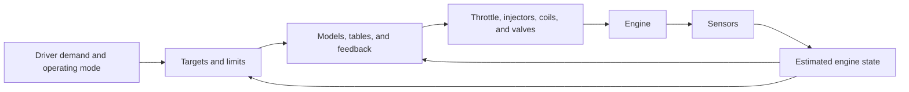

# Engine Control 101

An engine control unit (ECU) coordinates air, fuel, and ignition so an engine
produces useful torque, starts reliably, runs smoothly, and stays within its
operating limits. The challenge is doing all of these as speed, temperature,
driver demand, and external loads change.

This overview focuses on four-stroke, spark-ignition engines and uses rusEFI
examples. It explains the purpose of the control strategies; the linked
documents at the end describe their implementation. Available features depend
on the ECU hardware, sensors, firmware build, and configuration.

## What are we trying to achieve?

| Goal | What it means for the controller |
| --- | --- |
| Deliver requested torque | Respond predictably to the accelerator and coordinate changes in air, fuel, and spark. |
| Start and keep running | Establish engine position, support cold combustion, and prevent stalls as loads change. |
| Provide smooth operation | Avoid hesitation, surging, abrupt torque changes, and unstable idle. |
| Use fuel efficiently | Match fuel to the available air and choose effective combustion timing. |
| Manage emissions | Control mixture and combustion stability; where fitted, support effective catalyst operation. |
| Protect the engine and hardware | Respect speed, pressure, temperature, injector, and ignition-coil limits, and respond to faults. |

These goals involve tradeoffs. A cold engine may need extra fuel and air to run
reliably. High-load operation may require a different mixture and less ignition
advance than would be chosen for efficiency alone. A protection limit can take
priority over the driver's request for more torque.

Torque is the engine's turning effort. Power combines torque and rotational
speed. Engine speed rises when engine torque exceeds the torque required by
friction, accessories, and the connected load. At idle, the ECU actively balances
those demands to hold a target speed; while driving, speed also depends on the
transmission and vehicle load.

## The engine as a controlled system

The ECU measures what it can, estimates quantities it cannot measure directly,
chooses targets, and commands actuators. Sensors then report the result.



Three main controls work together:

- **Air** determines how much oxygen is available in each cylinder. Throttle
  position, idle air, boost, and valve timing affect cylinder filling. With a
  cable throttle, the driver directly controls the main throttle; an electronic
  throttle gives the ECU control of its position.
- **Fuel** must match that air and the desired mixture. Injectors meter fuel by
  opening for a calculated duration. Adding fuel alone does not provide a
  proportional increase in torque when the air supply stays the same.
- **Spark** determines when combustion begins. Changing timing changes how
  effectively the cylinder charge produces torque and how much stress and heat
  combustion creates.

Airflow changes take time to travel through the intake and fill the cylinders.
Spark changes can affect the next available combustion event. This gives the ECU
both a way to change sustained torque through air and a faster way to trim torque
through ignition timing.

Thinking in terms of torque helps explain the goals. It does not imply every
rusEFI setup uses a single torque-request controller: individual controllers can
work with throttle position, air mass, RPM, or pressure targets.

### Position and timing come first

A four-stroke cycle spans two crankshaft revolutions, or 720 degrees: intake,
compression, power, and exhaust. The ECU needs rotational speed and crank
position to place fuel and spark events correctly. Cylinder-specific sequential
operation also needs cycle phase, commonly established with a camshaft signal.

Trigger decoding turns crank and cam sensor edges into this position estimate.
Injection duration and coil charging time are measured in time, while spark and
injection placement relate to crank angle. The scheduler connects the two as RPM
changes. Computing the right fuel quantity is useful only if the ECU delivers it
at the intended time.

## The main control strategies

### Tables and models provide the starting command

An **open-loop** strategy commands an output without correcting it from the
measured result of that particular control task. It can still use many sensors.
For example, open-loop fueling uses RPM, estimated air mass, and temperatures
without using measured exhaust lambda to correct the mixture.

Calibration tables describe how the engine behaves across operating conditions.
RPM and load commonly select a table location, with interpolation between cells.
Physical models handle relationships such as air density and injector flow.

**Feedforward** means anticipating the command needed for a known demand or
disturbance. An idle-air increase when the air-conditioning compressor is about
to engage can prevent much of the RPM drop before it happens.

### Feedback corrects the remaining error

A **closed-loop** controller compares a target with a measurement and adjusts an
output to reduce the difference. Examples include:

| Controlled quantity | Feedback measurement | Corrective action |
| --- | --- | --- |
| Fuel mixture | Exhaust lambda | Adjust injected fuel mass. |
| Idle speed | RPM | Adjust idle airflow and, when enabled, ignition timing. |
| Electronic throttle position | Throttle position sensor | Drive the throttle motor. |
| Boost pressure | Manifold pressure | Adjust wastegate control. |
| Variable valve timing (VVT) | Cam position relative to crank position | Adjust the cam-control valve. |

Many controllers combine a table-based starting command with feedback. A PID
controller is one common feedback method: proportional action responds to the
current error, integral action corrects accumulated error, and derivative action
responds to how quickly the error changes. A given controller may use only some
of these terms.

Feedback has limits. Sensors have noise and delay, actuators have finite range,
and the engine takes time to respond. Excessive correction can cause oscillation.
Output limits and anti-windup prevent an integral term from continuing to build
when an actuator cannot provide more correction. Feedback is enabled only when
the relevant measurements and operating conditions support it.

### Adaptation learns persistent corrections

Short-term fuel trim corrects current mixture error. Long-term fuel trim can
learn recurring corrections across operating regions, reducing the work needed
from short-term feedback. Learning requires suitable conditions and bounded
authority; a persistent large correction can indicate a sensor, fuel-system, or
base-calibration problem.

Closed-loop control is specific to each task. Fueling can be open loop while
throttle position and idle speed remain under closed-loop control.

## Estimating air and choosing fuel

The important fueling quantity is the air mass entering a cylinder for a
combustion event. **Load** describes how heavily the engine is operating at its
current speed, but its numerical representation depends on the chosen strategy.
An axis labelled load might represent manifold pressure, throttle position, or
relative cylinder filling; its units matter.

rusEFI has several ways to estimate cylinder air mass:

| Strategy | Main inputs and idea | Main dependency |
| --- | --- | --- |
| Speed density | Use RPM, manifold absolute pressure (MAP), estimated charge temperature, displacement, and volumetric efficiency (VE). | A calibrated filling model and representative pressure and temperature inputs. |
| Alpha-N | Use throttle angle (alpha) and engine speed (N) to describe cylinder filling. | A calibrated throttle/RPM relationship; throttle position alone does not measure air mass. |
| Mass airflow (MAF) | Measure incoming airflow and use RPM and cylinder count to estimate mass per cylinder event. | Sensor calibration and how well measured intake flow represents cylinder filling, especially during transients. |

VE describes cylinder filling relative to a reference amount of air. Its table
captures changes in breathing with operating point. Charge temperature is an
estimate of the air temperature relevant to cylinder filling; heat transfer in
the intake means it can differ from the intake temperature sensor reading.

The desired mixture is often expressed as **lambda**:

- Lambda = 1 means the stoichiometric air/fuel ratio for the fuel in use.
- Lambda < 1 means richer: more fuel relative to air.
- Lambda > 1 means leaner: less fuel relative to air.

Stoichiometric means the chemically balanced air/fuel proportion. Its numerical
air/fuel ratio changes with fuel composition, so lambda provides a useful common
reference for gasoline and ethanol blends. The target can vary with operating
conditions; lambda = 1 is not a universal target for every mode.

The basic relationship is:

```text
base fuel mass = cylinder air mass / (target lambda * stoichiometric air/fuel ratio)
```

Starting, temperature, transient, and fuel-trim corrections modify this request.
An injector model then converts fuel mass into an opening duration using injector
flow and opening-delay characteristics, including battery-voltage effects.
Injector capacity and the available injection window constrain what can actually
be delivered.

Exhaust lambda feedback arrives after combustion and exhaust transport. It helps
correct mixture errors, but cannot anticipate the first cycles after a sudden
throttle movement. Transient strategies anticipate changes in airflow and, with
port injection, fuel temporarily deposited on or released from intake surfaces.
In rusEFI, acceleration enrichment and wall-film compensation are separate
mechanisms that can work together.

## Choosing spark and managing airflow

Combustion takes time, so spark commonly occurs before the piston reaches top
dead center (TDC) on compression. **Ignition advance** expresses how early it
occurs, usually in degrees before TDC. The aim is to place combustion where it
produces useful work within the engine's knock and thermal limits. More advance
does not always produce more torque.

A base timing table uses RPM and load, with corrections for conditions such as
temperature and detected knock. Knock is abnormal combustion that can damage the
engine; knock control, when available and calibrated, can reduce advance in
response. The ECU also controls **dwell**, the time spent charging the ignition
coil before firing. Dwell and spark advance serve different purposes.

Other airflow controls support the same overall goals:

- **Idle control** supplies enough air to balance friction and accessory loads.
  A temperature-dependent base command handles the expected demand; RPM feedback
  handles the remaining error. Spark trim can catch fast disturbances while
  airflow catches up.
- **Boost control** regulates turbocharger wastegate actuation using an open-loop
  command, optionally with pressure feedback. A boost target is an operating
  request; an overboost cut is a separate protection limit.
- **VVT control** moves cam timing toward a target chosen for the operating
  point. This changes cylinder filling and therefore affects fuel demand and
  torque as well as valve timing itself.

## Strategy changes with operating conditions

The same control rules are not appropriate throughout an engine's operation.

| Condition | Main concern | Typical strategy |
| --- | --- | --- |
| Cranking | Establish synchronization and achieve the first stable combustion events. | Dedicated fuel, spark, and air settings suited to temperature and low speed. |
| After start and warm-up | Keep combustion stable while the engine heats up. | After-start enrichment, temperature-based warm-up enrichment, and extra idle air. These corrections can overlap. |
| Warm idle | Balance varying loads without stalling or hunting. | Base airflow plus RPM feedback, optional spark trim, and anticipated accessory-load compensation. |
| Steady operation | Deliver smooth torque with appropriate mixture and timing. | Calibrated air/fuel and ignition models, with feedback where enabled. |
| Acceleration | Handle rapid changes before delayed feedback arrives. | Transient fuel compensation and coordinated air, fuel, and spark changes. |
| Overrun and return to idle | Manage closed-throttle deceleration and catch the engine before it stalls. | Conditional deceleration fuel cut, fuel restoration, and a controlled return of idle airflow. |
| High load or a fault | Respect combustion, thermal, and hardware limits. | Appropriate mixture and timing targets, limits on demand, or fuel/spark cuts as configured. |

Transitions matter as much as steady operation. Hysteresis uses different entry
and exit thresholds to prevent rapid switching near a boundary. Tapers and
blending avoid abrupt changes when moving from cranking to running or from
coasting to idle.

Protection supervises ordinary control. In rusEFI, `LimpManager` can inhibit
injection, ignition, or electronic throttle and records a reason for the
intervention. Invalid or stale sensor inputs also require an explicit response:
a suitable fallback where available, reduced operation, or stopping the affected
function. The response depends on which measurement was lost and which control
strategy needs it.

## Putting the pieces together

Consider a warm engine idling when the air-conditioning compressor is requested:

1. The idle controller anticipates extra load and increases its base air command.
2. As cylinder air mass increases, the fueling calculation supplies matching fuel
   at the target lambda.
3. When the compressor engages, RPM feedback corrects the remaining speed error.
   If enabled, ignition trim provides a faster torque adjustment.
4. Lambda feedback corrects residual mixture error once the exhaust measurement
   reflects the new operating condition.
5. Actuator and protection limits still constrain all of these actions.

This interaction explains why calibration and diagnosis must consider the whole
system. An idle-speed problem can originate in airflow, fueling, ignition,
unexpected mechanical load, or a misleading sensor reading.

Useful logs distinguish the **target**, **measurement**, **base command**,
**correction**, **final output**, and **active mode or limiting reason**. That
separation helps explain whether a controller requested the wrong result,
misjudged the engine state, or reached a physical limit while trying to correct it.

## Further reading

- [Sensor framework](AI/sensors_system.md): how measurements become usable inputs.
- [Fueling system](AI/fueling_system.md): fuel-mass calculations and injector commands.
- [Cold-start logic](AI/cold_start.md): cranking, after-start, and warm-up behavior.
- [Acceleration enrichment](AI/acceleration_enrichment.md): transient fueling and wall wetting.
- [Ignition system](AI/ignition_system.md): advance, dwell, and spark scheduling.
- [Idle control](AI/idle_system.md): airflow, RPM feedback, and timing trim.
- [Engine protection](AI/protection_system.md): permissions, cuts, and diagnostic reasons.
- [Scheduling and timing](AI/scheduling_system.md): turning calculated commands into timed events.
